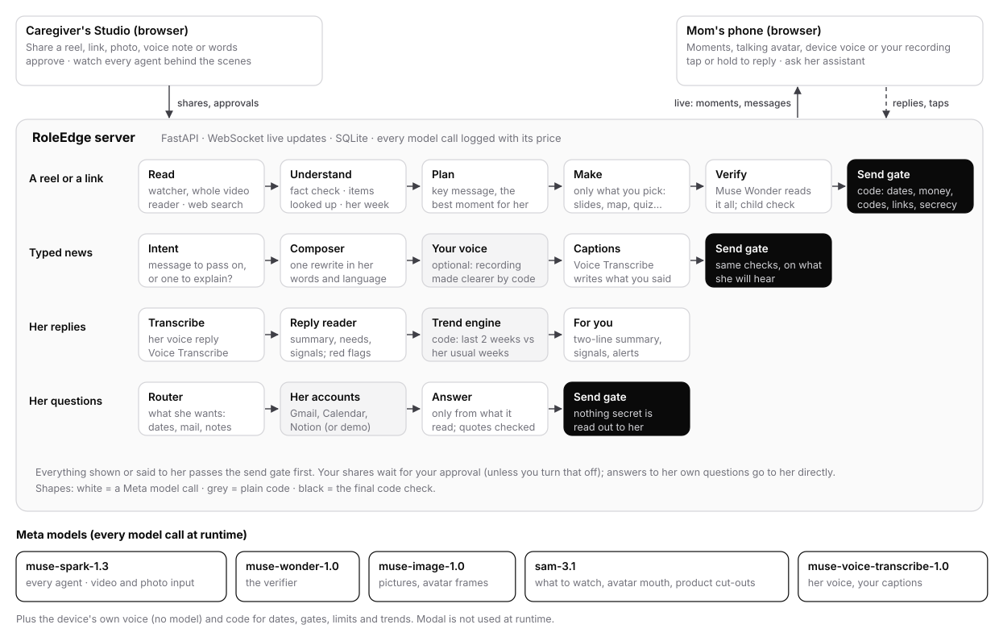

# RoleEdge

RoleEdge helps a grown child care for a parent who lives far away. The child shares a reel, a link, a photo or a few
typed words. A team of agents researches it, checks the facts and suggests the best way to explain it to the parent:
a short note, slides, a mind map, a gentle quiz, an animated video, a picture or a fridge card. Only the moments
you pick are made. The parent's replies come back as a summary and a weekly trend. Every model call goes to Meta
models.

The app comes with two made-up families:

| Family | Caregiver | Parent | Grandchild |
|---|---|---|---|
| `chen` (English) | Maya, her daughter | "Mom", Linda | Leo, 9 |
| `sato` (Japanese) | Kenji, her son | "Okaasan" | Hana, 8 |

## How it works



- **A reel or a link** goes through a team of agents in stages. Agents in the same stage run in parallel. They read
  it (the watcher sees the whole video), check its claims on the web, look up each film, product or song it names,
  think about how she takes things in, then plan. Only the moments you pick are made, one maker each. Muse Wonder
  verifies them. Code runs the final send gate (dates, money, codes, links, secrecy, pressure) before she sees
  anything.
- **Typed news** is read for intent first. A message to pass on ("I'll call after my meeting") takes the fast way:
  one rewrite in her words, no research. You can also say it in your own voice. Code makes the recording clearer,
  and Voice Transcribe writes her captions.
- **Her replies**, typed or spoken, become a two-line summary, her needs and today's signals. A trend engine (code)
  compares her last two weeks with her own usual weeks.
- **Her questions** ("when is my appointment?") are answered by her assistant. It uses only what it read in her
  calendar, mail or notes, and the quotes it gives are checked by code.

## The models

| Model | What it does in RoleEdge | Price (Meta Model API) |
|---|---|---|
| `muse-spark-1.3` | Every agent. Watches the whole video (video input) and reads photos. Searches the web, writes strict JSON against a schema for each agent, and writes in her language. | $1.25 / $4.25 per million tokens in / out ($0.15 cached). The contributor variant costs $0.10 / $0.20 |
| `muse-wonder-1.0` | The verifier: reads every finished pack against the research before you approve it. Also the judge in our tuning lab. | $4 / $20 per million tokens in / out |
| `muse-image-1.0` | The picture moment, and the caregiver avatar's portrait with its mouth and blink frames | $0.01 per image |
| `sam-3.1` | Marks what to watch in each still of a video, finds the avatar's mouth and eyes, and cuts products out of a reel's frame | $2.50 per 1,000 images |
| `muse-voice-transcribe-1.0` | Her voice replies, and the captions for your own recordings | $0.18 per hour of audio |

**More facts:**

- **14 agent roles** in the Studio. Each has its own instructions, output schema and checks. There are
  **10 moment formats**: 7 for a parent, and 6 for a child (picture story, quiz game, ask Grandma and more).
- **No model decides alone what she sees.** Dates must appear in what you shared, the send gate is code, and a pack
  for a grandchild gets its own child-safety review.
- **Voice is the device's own voice**, with no model involved: the most natural voice the browser has, whole
  sentences with pauses. Meta has no text-to-speech model, and the organisers ruled that every model called at
  runtime must be a Meta model.
- **Tuned on real reels:** 44 Instagram reels (41 with a video), 418 runs through the agents, 1,883 moments made and
  judged, 43 measured changes. All of it is on the `/lab` page.
- **Fine-tuned child model:** [Llama-Garvit-1.0](https://huggingface.co/pra40109/Llama-Garvit-1.0), a LoRA on Llama
  Guard 3 1B. On held-out lines it caught 99.6% of unsafe lines, against 52% untrained. It is research only and
  doesn't run in this build, because Llama doesn't count as a Meta model here.
- **Speed and cost, measured:** a quick message takes about 5 seconds. A reel's research takes about a minute, and
  each moment takes 20 to 30 seconds more. Every call is logged with its price in `output/usage.jsonl`.
- **171 automated tests** (`pytest`).

## What you need

- **A Meta Model API key** from dev.meta.ai.
- **Python 3.11 or newer.**
- **ffmpeg**, for videos, reel links and voice recordings. Typed messages and web pages work without it.
- An internet connection. The first run installs about 250 MB of Python packages into the folder.

## Run it

Unzip, then put your key in the settings file: copy `.env.example` to `.env`, open `.env` and fill in
`META_API_KEY="..."`. Nothing else is required. The start script then installs the app the first time (a few
minutes), checks the key with one tiny call and starts the server. Open **http://localhost:8100**.

### macOS

```bash
brew install python@3.12 ffmpeg        # once; or Python from python.org
cd roleedge
cp .env.example .env                    # then add your key to .env
bash run.sh
```

### Ubuntu (and other Linux)

```bash
sudo apt install python3 python3-venv ffmpeg     # Ubuntu 22.04: also python3.11 python3.11-venv
cd roleedge
cp .env.example .env                              # then add your key to .env
bash run.sh
```

### Windows 10 or 11 (PowerShell)

```powershell
winget install Python.Python.3.12 Gyan.FFmpeg     # once; then open a new PowerShell window
cd roleedge
copy .env.example .env                            # then add your key to .env (notepad .env)
powershell -ExecutionPolicy Bypass -File run.ps1
```

The Windows script hasn't been tested on a Windows machine yet. If it fails, these are the same steps by hand:

```powershell
$env:PYTHONUTF8 = "1"
py -3.12 -m venv .venv
.venv\Scripts\python -m pip install -e .
.venv\Scripts\roleedge serve --port 8100
```

Port 8100 already in use? Run `PORT=8200 bash run.sh` (macOS, Linux) or `$env:PORT=8200; .\run.ps1` (Windows).

## What to open

Put the caregiver's screen and the parent's phone side by side. The phone updates live.

| Page | What it is |
|---|---|
| http://localhost:8100/ | The home page |
| http://localhost:8100/studio | **The caregiver's Studio**: share something, approve what goes out. **Behind the scenes** (bottom left) shows every agent at work |
| http://localhost:8100/phone/chen | **Linda's phone** (English) |
| http://localhost:8100/phone/sato?subs=1 | Okaasan's phone (Japanese; `?subs=1` adds English subtitles) |
| http://localhost:8100/lab | **The tuning lab**: 44 real reels, 7 rounds of tuning, the judges' scores and every change we made |

## Things to try

1. **Share a reel.** In `/studio`, with **Mom** picked under "Explain it to", press **Link** and paste a public
   Instagram, YouTube or TikTok link, or use **Photo or video** to upload a short one. Press **Research and plan**.
   The agents watch it, check it and pick the best moment for her. Press **Make**, read it, then **Approve and
   send**; it arrives on `/phone/chen`. Under the card you can **add another moment** (a quiz, a mind map, a video),
   made on its own. If a link won't download (some sites block it), upload the video file instead.
2. **Send typed news.** Type "tell mom I'll call after my meeting at 6" and send it. It is recognised as a message to
   pass on and takes the fast way. On the card, **Record** lets you say it in your own voice, and Mom hears you
   instead of the device voice.
3. **Reply as Mom.** On her phone, tap a reply, or hold the microphone and talk ("I didn't sleep well, and we're out
   of rice"). The caregiver gets a short summary, her needs and today's signals.
4. **Ask her assistant.** On her phone, ask "when is my doctor's appointment?" or "what goes in my chicken soup?".
   It answers from the prefilled demo calendar, mail and notes.
5. **A grandchild.** Pick **Leo** under "Explain it to". The same content comes back as a picture story, a quiz
   game and more, checked for a 9-year-old.

To start over with clean demo families, stop the server and run `.venv/bin/roleedge serve --reset`
(Windows: `.venv\Scripts\roleedge serve --reset`).

## What it costs on your key

| Action | Muse Spark 1.3 (default) | Muse Spark 1.3 contributor |
|---|---|---|
| A reel's research and plan, plus its best moment | a few cents | about a cent |
| All five moments of a reel (research, five makers, verification, picture) | about $0.15 | about $0.04 |
| A quick message or a reply | under $0.01 | under $0.01 |
| A minute of voice transcribed | $0.003 | $0.003 |

New Studio shares stop at $10 of spend. Change `ROLEEDGE_STUDIO_SPEND_CAP_USD` in `.env` to raise it. The
contributor model is cheaper because Meta trains on what is sent to it. That is acceptable for these made-up families,
but not for real ones, so the app only uses it when you also set `ALLOW_CONTRIBUTOR_MODELS="1"`.

## Good to know

- **Voice.** Edge's "Natural" voices sound best. Browsers only speak after a first tap on the page. The Studio's copy
  of her screen stays silent, so only her phone speaks.
- **Gmail, Calendar and Notion.** Without your own Google OAuth client or Notion token in `.env`, the prefilled demo
  accounts answer.
- **The lab page** shows the results of our tuning rounds. The reels themselves, their stills and the product photos
  found online are other people's content, so they are not included.
- **Your data stays on your machine.** It is kept in `output/` (SQLite and uploads). The server only listens on
  `localhost`.

## Something went wrong

| You see | Do this |
|---|---|
| `Add your Meta Model API key ...` | Put the key in `.env` as `META_API_KEY="..."` |
| `The Meta key didn't work` | Check the key at dev.meta.ai, and that it can use `muse-spark-1.3` |
| `ensurepip is not available` (Ubuntu) | `sudo apt install python3-venv` (or `python3.12-venv`) |
| `running scripts is disabled` (Windows) | Start it with `powershell -ExecutionPolicy Bypass -File run.ps1` |
| `Address already in use` | Use another port (see above) |
| A video or voice note fails | Install ffmpeg |
| No sound on the phone | Tap the page once, check the volume, or try Edge |

## Where things are

- `src/roleedge/`: the app. `studio/` holds the research swarm and makers, `app/` the server, `compose/` the quick
  path, `errands/` the assistant, `trends/` the trend engine, `lab/` the tuning lab.
- `web/app/`: the screens.
- `tests/`: `.venv/bin/python -m pip install -e ".[dev]"`, then `.venv/bin/python -m pytest`.
- `docs/`: the design (`PIVOT.md`, `HACKATHON.md`), the tuning log (`REEL_LAB.md`, `reel-lab/`), what we found
  (`FINDINGS.md`) and the connections (`reel-lab/INTEGRATIONS.md`).
